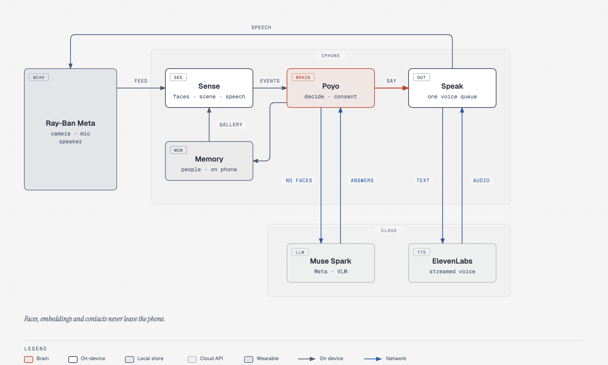
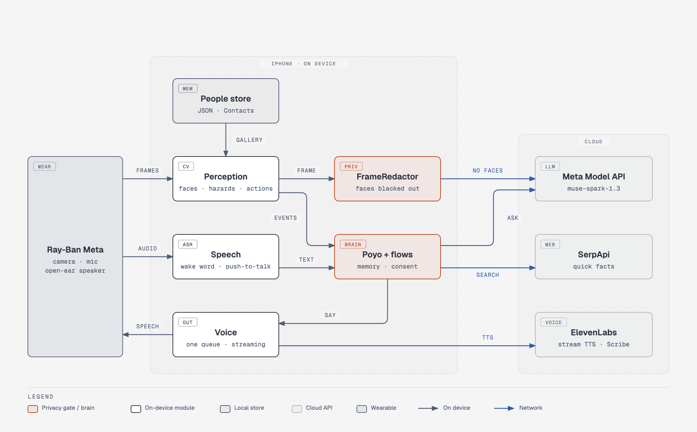
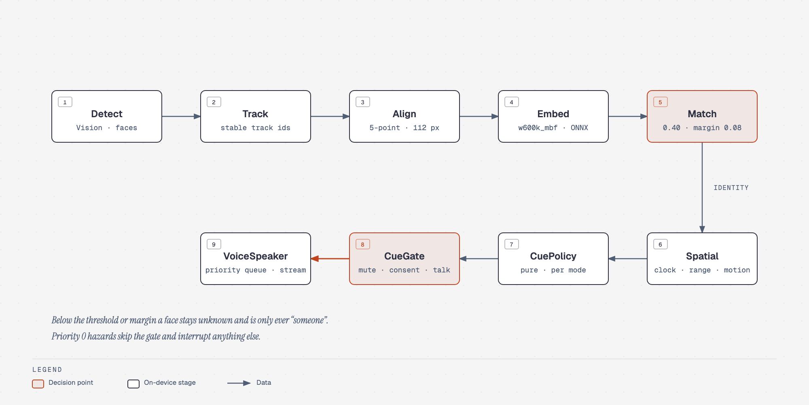
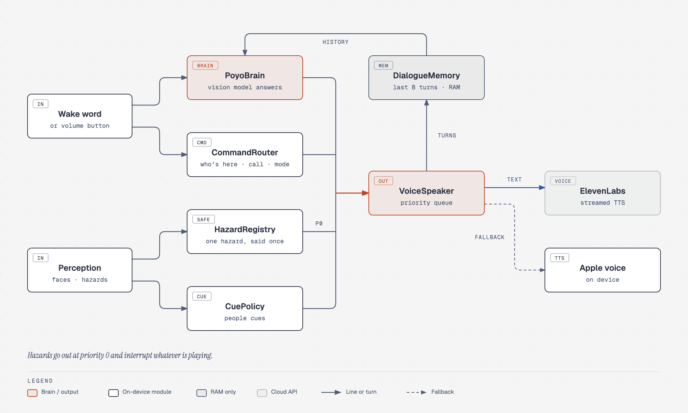
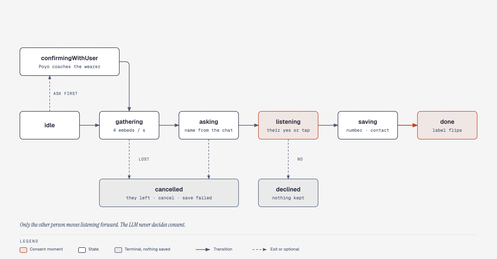

# Familiar

Social awareness for blind and low-vision people wearing Ray-Ban Meta Gen 2 glasses. Built at HackTX 2026.

The glasses are the camera, mic and speaker. The iPhone does all the thinking. Familiar tells the wearer which friends are nearby ("Marcus, 12 o'clock, close."), who is walking up or leaving, and what is in their walking path ("Stairs down, 12 o'clock, 3 meters."). Poyo, the always-on assistant, answers questions about the scene ("Poyo, what's in front of me?").

Only people who said yes are ever recognized. Everyone else is "a person" or "someone", and every face is blacked out on the phone before an image goes anywhere.



## Architecture



Familiar is one SwiftUI app with no backend. Everything personal (faces, embeddings, consent clips, contacts) stays on the phone. The cloud only sees redacted frames and short text.

| Layer | Folder | What it does |
|---|---|---|
| Sources | `Familiar/Sources` | `GlassesFrameSource`, `PhoneCameraFrameSource` or `VideoFileFrameSource` (fixtures) produce `Frame`s |
| Perception | `Familiar/Perception` | face detect, track, align, embed, match, bearing and distance, plus `SceneAwareness` for hazards |
| Audio and speech | `Familiar/Audio`, `Familiar/Speech` | `AudioEngineController` owns the audio session; `Transcriber` keeps a rolling 90 s transcript in RAM; `WakeWord` (or a volume-button press, push-to-talk) and `CommandParser` turn speech into `Command`s |
| Voice | `Familiar/Voice` | `CuePolicy` and `NarrationPolicy` decide what to say, `CueGate` decides if now is a good time, `HazardRegistry` keeps one alert per hazard, `VoiceSpeaker` is the one priority queue that says it (streamed ElevenLabs, Apple voice fallback), `DialogueMemory` keeps the last 8 turns |
| Poyo | `Familiar/Voice/PoyoBrain.swift` | scene answers, follow-ups, contact offers, renames |
| Memory | `Familiar/Memory` | `JSONPeopleStore` and `ContactsBridge` (iOS contacts, `tel:` and `sms:`) |
| Flows | `Familiar/Flows` | `ConsentFlow`, `CommandRouter`, `RollCall` |
| Intelligence | `Familiar/Intelligence` | name extraction, yes/no classification, `VisionLLMClient` |
| UI | `Familiar/UI` | onboarding, Today, Room radar, People and places map, You (vision profiles, accessibility), Judge view, consent card, self-enroll |

`Services.make(source:state:)` builds the object graph and `FlowRuntime.bind` wires the flows and Poyo on top of it. Every producer exposes `subscribe() -> AsyncStream<T>`, so modules never hold references to each other's internals. The full set of contracts is in [`Familiar/Core/Contracts.swift`](Familiar/Core/Contracts.swift).

### Seeing people



A frame goes through Vision face detection, a tracker that keeps stable track ids, five-point alignment to 112×112, and the `w600k_mbf` ONNX embedder running on device. The matcher compares against the gallery of consented people and only accepts a name when the best score clears 0.40 and beats the runner-up by 0.08. Anything less is unknown. Getting a name wrong is worse than saying "someone".

Spatial turns the face box into a clock position from the true field of view (the 53° glasses view spans 11 to 1 o'clock) and a distance band. Trajectory tracking emits approach and leave events. `CuePolicy` is a pure function from events to utterances, and `CueGate` holds them back while the wearer is talking, while consent is running, or in quiet mode. Priority 0 hazards always go through.

### Seeing the scene

`CloudScene` keeps the latest frame and sends it to the vision model when the scene changes or on a heartbeat. Before it leaves the phone, `FrameRedactor` runs a fresh face detection, merges in the tracked boxes, and blacks them out with a 35% margin. If face detection can't run, nothing is uploaded.

`VisionLLMClient` talks to any OpenAI-compatible endpoint and defaults to the Meta Model API with `muse-spark-1.3`. Alongside the redacted JPEG it sends `WorldModel.contextLine`, a short text summary of what the phone already knows: names of consented people in view with clock positions, a count of anyone else, recent hazards and how old the reading is. Names never come back from the cloud.

On device, `SceneAwareness` looks for stairs, walls and obstacles with Vision and watches for the view steadily expanding. `MotionState` decides whether the wearer is walking, and path alerts only play while they are. `ActionCaptioner` adds short captions like two people talking side by side, never what anyone looks like.

### Poyo, one voice



Poyo only answers "Poyo, …", the sentence after a volume-button press, or a quick follow-up to its last answer. It never joins a conversation on its own. Fixed commands (who's here, call, text, mode, mute) go through `CommandRouter`; everything else goes to `PoyoBrain` and the vision model.

Every line, from any of these lanes, goes through one `VoiceSpeaker` queue. Hazards are priority 0 and interrupt. The on-device detector and the vision model share a `HazardRegistry`, so the same stairs are never announced twice. ElevenLabs audio is streamed so the first word comes fast, with the Apple voice as a fallback, and common names and alerts are prewarmed. Each spoken line is a turn in `DialogueMemory`, which the model gets as chat history, so "say that again" and "which side is the door?" work.

### Remembering someone new



The wearer can't add anyone. When Poyo notices a real conversation with an unknown face, it quietly suggests the wearer ask. From there `SpokenConsentFlow` gathers a burst of embeddings, picks up a name from the conversation, and listens for the other person's yes. A tap on the consent card or self-enrollment ("Introduce yourself", or `familiar://introduce`) works too. The LLM never decides consent.

Poyo can rename someone ("Poyo, change their contact to Anish"), including the iOS contact. Removing a person deletes the record, thumbnail, consent clip and the iOS contact the app created.

### Privacy rules

These are enforced in code and shown on the Judge view banner. See [AGENTS.md](AGENTS.md) for the full list.

- Strangers are never named, described or stored
- Consent comes from the other person, by voice or tap
- Faces, embeddings and consent clips never leave the phone
- Every uploaded frame passes through `FrameRedactor`
- Audio is limited to the 90 s transcript in RAM and a few-second consent clip
- No mood reading, no speaking or messaging on the user's behalf

## Demo and branches

[docs/DEMO_TALKING_POINTS.md](docs/DEMO_TALKING_POINTS.md) lists every feature, what we used and why, split by who presents it.

Not on `main` yet: the Instagram and Muse samples (`keane`, `samples/muse`, standalone Python).

## Build and run

Requirements: Xcode 26.4 or newer (the glasses SDK needs it), and an iOS 18+ device or an iPhone 17 simulator.

```bash
cp Secrets.example.xcconfig Secrets.xcconfig          # fill in keys, never commit this file
open Familiar.xcodeproj                                 # scheme "Familiar"
xcodebuild -scheme Familiar -destination 'platform=iOS Simulator,name=iPhone 17' CODE_SIGNING_ALLOWED=NO test
```

On a device, pick your personal team under Signing & Capabilities once. The bundle id is `com.familiar.hacktx`. In the Simulator the app uses the fixture source (`mixed.mp4`) with `ScriptedPerception`, `FakeTranscriber` and `LogSpeaker`, so the Judge view shows scripted boxes and spoken cues without any hardware.

### UI build notes
The SwiftUI redesign from the `sahas` branch is on `main` ([DESIGN_SPEC](docs/DESIGN_SPEC.md), [DESIGN_SYSTEM](docs/DESIGN_SYSTEM.md), [UI_CONTRACTS](docs/UI_CONTRACTS.md)). Build notes:

- **Fonts.** Plus Jakarta Sans Regular/Medium/SemiBold/Bold live in `Familiar/Resources/Fonts/` and are registered in `Familiar/Info.plist` under `UIAppFonts`. Every label goes through `FamiliarType.*(scale)`; if the fonts ever go missing from the bundle, `FamiliarFont` falls back to the rounded system face instead of Times New Roman.
- **libraries.dev kits.** Six products of the `Libraries.dev` package (branch `main`, pinned in `Package.resolved`) are linked to the app target in `project.pbxproj`: `BotAvatarsKit` (Mimo), `ThinkingOrbsKit` (status orb), `VoiceGlowKit` (consent card glow), `BorderBeamKit` (nearby card and consent card beams), `MetalFxKit` + its dependency `MagnetKit` (the liquid-metal "Who's here?" ring). Xcode resolves them on first open; if resolution fails, File → Packages → Resolve Package Versions. The MetalFx shaders compile as part of the normal build.
- **iOS 18 APIs.** `MeshGradient`, `Color.mix`, `Group(subviews:)` and `onScrollPhaseChange` are used unguarded because `IPHONEOS_DEPLOYMENT_TARGET` is 18.0. The one iOS 26 API (`glassEffect` on the pager's edge strips) sits behind `#if compiler(>=6.2)` + `if #available(iOS 26, *)`, so Xcode 16 builds the material fallback and Xcode 26 the liquid glass.
- **Launch arguments.** `--onboarding` replays the first-launch flow; `--glasses` opens the glasses registration directly and boots the pipeline at once; `-demoConsentCard` shows the consent card over the tabs for screenshots.
- **First launch.** Onboarding runs before the pipeline boots, so no camera or microphone prompt appears over the Welcome page; the permissions checklist (`ReadinessView`) is the Privacy page's Continue step and reappears once on Today if it was skipped.
- **Snapshots.** `SNAPSHOT_DIR=$PWD/docs/snapshots xcodebuild … -only-testing:FamiliarTests/SnapshotRenderTests test` renders Welcome, Today, Room radar, People, consent card, Accessibility settings and Mimo at the balanced and severe vision profiles.
- **What was not possible on the design machines.** The branch was written on Macs without an iOS SDK: every file passes `xcrun swiftc -parse` (Swift 5 and 6 modes) and the kit signatures were checked against the pinned libraries.dev sources, but the first real `xcodebuild` happens on your Mac. If something fails to type-check, the usual suspects are listed in docs/HANDOFF.md under "Design branch (sahas)".

### Secrets

`Secrets.xcconfig` → Info.plist keys → `Familiar/App/Secrets.swift` (nil when empty). Keys: `ELEVENLABS_API_KEY`, `ELEVENLABS_VOICE_ID`, `ELEVENLABS_AGENT_ID`, `META_MODEL_API_KEY`, `MODAL_EMBED_URL`, `MODAL_KEY`, `MODAL_SECRET`, `SERPAPI_KEY` (quick facts: "Poyo, look up the Longhorns game"; off when empty). URLs in xcconfig need `$()/` in place of `//` (`https:$()/$()/...`).

### Fixtures

`Familiar/Resources/Fixtures/` holds `*.mp4` clips (720×1280), `fixtures.json` with per-clip expectations, `*.txt` transcripts for `FakeTranscriber` and `script.json` for `ScriptedPerception`. Missing clips make the related tests skip, never fail.

## Project notes

The Xcode project uses synchronized folder groups (`Familiar/`, `FamiliarTests/`), so adding a file never edits `project.pbxproj`. It was generated once with XcodeGen, and `project.pbxproj` has been the source of truth since. Don't re-run `xcodegen` unless you're ready to re-add the later package changes.

Pinned dependencies: ONNX Runtime 1.24.2 (import `OnnxRuntimeBindings`), Meta Wearables DAT 1.0.1, ElevenLabs Swift SDK 3.4.0. `modal/embed_server.py` is an optional cloud twin of the embedder that receives aligned crops and discards them.

More docs:

- [FAMILIAR_MASTER_PLAN.md](FAMILIAR_MASTER_PLAN.md): demo, scope, decisions, schedule, risks
- [AGENTS.md](AGENTS.md): product rules, Swift contracts, conventions
- [docs/HANDOFF.md](docs/HANDOFF.md): device setup and test order
- [docs/DEMO_SCRIPT.md](docs/DEMO_SCRIPT.md) and [docs/CALIBRATION.md](docs/CALIBRATION.md)
- [devin/](devin/): the prompts for each parallel build session
- [TEAM_CHECKLIST.md](TEAM_CHECKLIST.md): the human track

The diagrams in `docs/diagrams/` are self-contained HTML made with [diagram-design](https://github.com/cathrynlavery/diagram-design). Edit the HTML and re-export the PNG.

## Licenses

InsightFace model weights (`w600k_mbf.onnx`, buffalo_sc) are released for non-commercial research use only, and this hackathon build uses them under that license. Everything else is MIT unless noted in the dependency.
